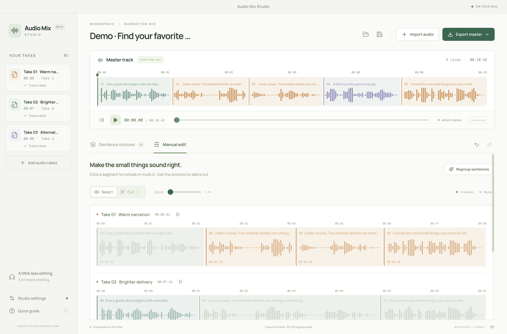

<p align="center"></p>

# Audio Mix Studio

**Every sentence. Your favorite take.**

A local macOS app for turning several AI voice recordings into one narration you love. Import your ElevenLabs takes, listen to the different versions of each sentence, and pick your favorite. Your master track updates as you choose.

Built for faceless YouTube channels, voiceovers, and anyone who has ever thought, “I like the first half of take one and the ending of take two.”


## What you can do

- **Compare sentences, not entire files.** Preview variations side by side and choose which take goes into the master.
- **Match meaning across scripts.** Codex groups the same idea even when the wording changes. Extra sentences become their own groups, with only the takes that contain them.
- **Make precise manual edits.** See every source waveform and its sentence cuts. Click to mute or include a segment, use the scissors to split it, or edit its start and end time. Active segments are colored; muted ones are gray.
- **Hear the final sequence.** The master stays at the top, with playback, seeking, and color-coded source clips.
- **Keep control.** Skip a sentence, move it up or down, combine pieces from different takes, and undo or redo edits.
- **Export real audio.** Download stereo 48 kHz, 24-bit WAV or 320 kbps MP3, with optional tiny edge fades to reduce clicks.
- **Save your work.** Automatic session recovery plus portable project files with their source audio. Export the complete transcript/alignment JSON too.
- **Choose your local speech model.** WhisperX defaults to `large-v3-turbo`; switch models in settings. Missing models download with progress and cancellation.

There is no chat interface. AI organizes your recordings in the background; you decide which delivery sounds best.

## Requirements

The initial desktop release supports **macOS 13 or later on Apple Silicon (M-series)**.

| Tool               | Purpose                             | Setup                                                                                 |
| ------------------ | ----------------------------------- | ------------------------------------------------------------------------------------- |
| FFmpeg and FFprobe | Decode, waveform, preview, export   | `brew install ffmpeg`                                                                 |
| Codex CLI          | Group equivalent sentences          | Install [Codex CLI](https://developers.openai.com/codex/cli/), then run `codex login` |
| WhisperX 3.8.6     | Local transcription and word timing | Prepared by the app in a private Python environment                                   |

Open **Studio settings** to check all tools. If Codex is missing or signed out, the app explains how to install/sign in; manual editing remains available. Discovery includes common Homebrew and `~/.local/bin` locations, so launching from Finder works without a shell PATH.

The transcription integration is adapted from [Vandashi](https://github.com/igormidev/Vandashi). It uses exactly the same WhisperX engine, CPU int8 inference, pinned model revisions, Silero speech detection, and word alignment. An existing verified Vandashi installation and downloaded model are reused read-only. Other downloads stay in Audio Mix Studio’s own cache. Vandashi does **not** need to be installed.

The default model is `large-v3-turbo`. On a new Mac, select **Prepare selected model** in settings to install the engine and download it. A missing selected model is also prepared during transcription. The first setup needs internet access, several GB of free disk space, and time to download Python dependencies and model weights. English and other supported alignment languages may download a separate word-timing model the first time they are used.

Available models: `tiny`, `base`, `small`, `medium`, `large-v3`, `large-v3-turbo`. Smaller models need less memory and may be less accurate. CPU transcription speed depends on your Mac and recording length.

## Run locally

Install [Node.js 22.12 or newer](https://nodejs.org/) and the tools above, then:

```sh
git clone https://github.com/igormidev/audio-mix-studio.git
cd audio-mix-studio
npm ci
npm run dev
```

For a production build:

```sh
npm run build
npm start
```

Build a macOS app or installer:

```sh
npm run package:dir
npm run package:mac -- --arm64
```

Outputs go into `release/`. Local builds are unsigned unless you configure your own Apple signing/notarization credentials. The repository does not include a signed/notarized public release or any credentials.

## Your first mix

1. **Import your takes.** Select one or more audio files or drop them into the window. WAV, MP3, M4A, AAC, FLAC, OGG, Opus, AIFF, and other common audio formats are supported. Imports are local copies; originals stay untouched.
2. **Let the app organize them.** Once transcription is prepared, the first import transcribes and groups automatically. A new Mac is guided to setup first. For additional takes, click **Group sentences**. You can see progress and cancel. Regrouping replaces cuts, with a warning first and Undo afterward.
3. **Choose each sentence.** Preview the variations, then click **Use take**. A sentence that appears in only one recording has one option. The first available take is selected initially; AI does not pretend to judge sound quality from text.
4. **Polish if needed.** In **Manual edit**, click a segment to toggle it. Use **Cut** and click inside a segment to split. Click or right-click a segment for exact start/end controls. Zoom for more precise placement.
5. **Export master.** Choose WAV for editing in your video app, or MP3 for a smaller file. Save the project if you want to return later.

Try **Explore a sample project** on the empty screen for three real, locally synthesized takes with shared and unique sentences. Demo groups are prepared examples; they are labeled as a demo and do not imply an AI analysis ran.



### A few useful details

- Sentence groups define master order. Within a group, enabled pieces play in take/import order, then source time. Enabling two full variations plays both; it does not mix them over one another. **Custom mix** identifies these selections.
- AI boundaries retain up to 60 ms of breathing room, clamped between adjacent cuts. Long silence between sentences is removed. You can extend a trim into unused source audio, but not across another segment.
- Split pieces retain their sentence text as context. Choosing that take again selects all surviving pieces. A variation preview plays those pieces in order, including any trims.
- Edge fades default to 8 ms. They do not overlap clips or change master duration. Set them from 0–20 ms in settings.
- Where forced alignment cannot reliably cover all spoken text, the app keeps the real ASR segment timestamps. It does not fabricate word timing.

### Keyboard shortcuts

| Shortcut | Action                         |
| -------- | ------------------------------ |
| Space    | Play/pause master              |
| ⌘I       | Import audio                   |
| ⌘O       | Open project                   |
| ⌘S / ⌘⇧S | Save / Save as                 |
| ⌘E       | Export master                  |
| ⌘Z / ⌘⇧Z | Undo / Redo                    |
| C        | Toggle cut tool in Manual edit |
| Escape   | Stop playback / leave cut mode |

## Your files and privacy

Audio normalization, WhisperX transcription, word alignment, waveform analysis, and exports run on your Mac. No audio is sent to Codex. **Transcript text is sent through your installed, signed-in Codex CLI** for semantic grouping, using your existing account and usage allowance. Internet access is needed for this step. The app uses Codex’s noninteractive [structured output](https://developers.openai.com/codex/noninteractive) workflow with an ephemeral read-only job, without user/project instructions or shell/web tools. The CLI’s built-in default model is used; the app does not require an OpenAI API key or expose a chat.

App data lives at:

```text
~/Library/Application Support/Audio Mix Studio/
  media/                 imported normalized audio and media index
  last-session.json      autosaved editing session and full transcripts
  transcription/         Python runtime, model downloads, and cache
```

Explicit **Save** creates `My mix.mixstudio` and `My mix.assets/` beside it. Keep both together when moving or backing up a project. The JSON contains your transcript and selections; the assets folder contains copied source audio. Saved portable projects do not depend on the original download folder or the app’s media cache.

There is no app analytics or hosted storage. Downloading dependencies/model weights contacts their official distribution hosts; Codex uses its existing authentication and network connection. Do not commit personal audio, transcripts, project files, or model caches to GitHub.

## Limits of the first version

- Apple Silicon macOS only; no Intel/Windows/Linux installer.
- Up to 50 source tracks and 20,000 segments in a project; exports support up to 5,000 enabled clips. Each source may be up to 16 GiB and 12 hours. Very large transcripts are rejected with an explanation when they exceed one AI analysis request (1.5 MB of input JSON); split those into smaller projects.
- Semantic matches are proposals. Review them, especially with substantially rewritten scripts, repetitions, or noisy transcription. Codex does not hear the audio or automatically choose the best sounding delivery.
- This is a narration assembly tool. It does not include multitrack music mixing, loudness normalization, equalization, pitch correction, or an ElevenLabs account integration.
- Setup requires network access. A completely fresh Python installation is a different path from reusing an existing verified environment; see verification notes below.

## Development and verification

```sh
npm run check       # strict TypeScript, ESLint, production build
npm test            # domain, edit history, playback planning, real FFmpeg, adapters
npx tsx scripts/smoke-electron.ts  # production Electron IPC/media, isolated profile
npx tsx scripts/smoke-ui.ts        # real sentence/manual editor interactions
npx tsx scripts/smoke-installed.ts # installed /Applications bundle, minimal Finder PATH
```

FFmpeg tests exercise real generated audio, including clip-order frequency checks and WAV/MP3 durations. Adapter tests reject invalid/incomplete AI ranges and verify download/cancellation handling. The native smoke run keeps Chromium’s OS sandbox enabled and uses the production media protocol. Only native dialog answers are replaced by the test harness.

The initial implementation was verified on an Apple Silicon Mac with the actual installed WhisperX and authenticated Codex CLI: two locally generated speech takes, default-model transcription/word alignment, semantic paraphrase matching, and a sentence unique to one take. A previously missing `tiny` model was downloaded with progress, verified, loaded, and discovered. A completely new multi-GB Python environment installation was not repeated on that already configured Mac.

See [architecture](docs/ARCHITECTURE.md) for boundaries, data flow, persistence, and security decisions. Contributions should keep the editing workflow simple and test meaningful audio behavior.

## Credits and license

MIT © 2026 Igor Miranda Souza. Transcription bootstrap/engine adapted from [Vandashi](https://github.com/igormidev/Vandashi), with its [MIT notice](resources/transcription/VANDASHI-LICENSE.txt) preserved. See [transcription resources](resources/transcription/README.md) for upstream engine/model licenses. Electron, React, FFmpeg, WhisperX, and Codex retain their own licenses; FFmpeg and Codex are external installations, not bundled in the app.
