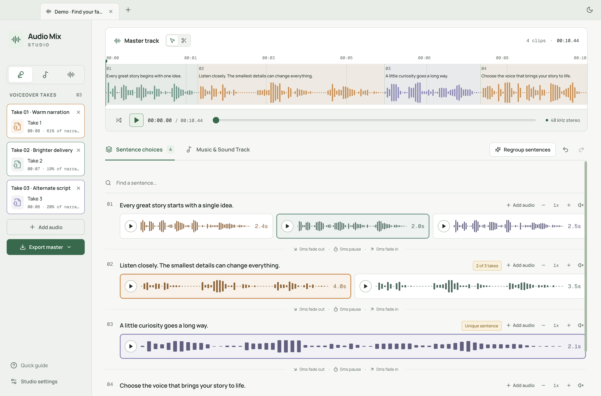
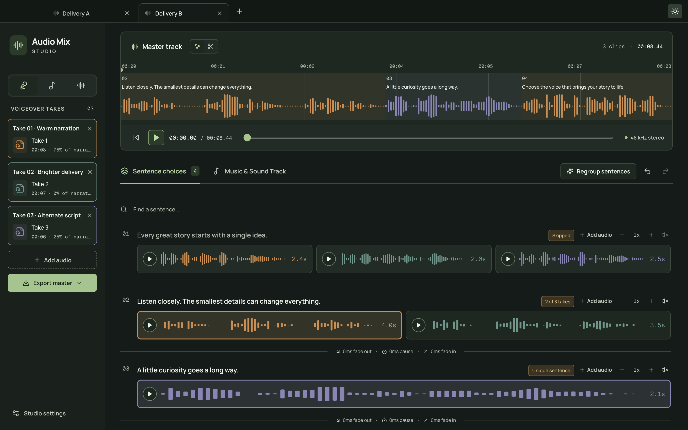
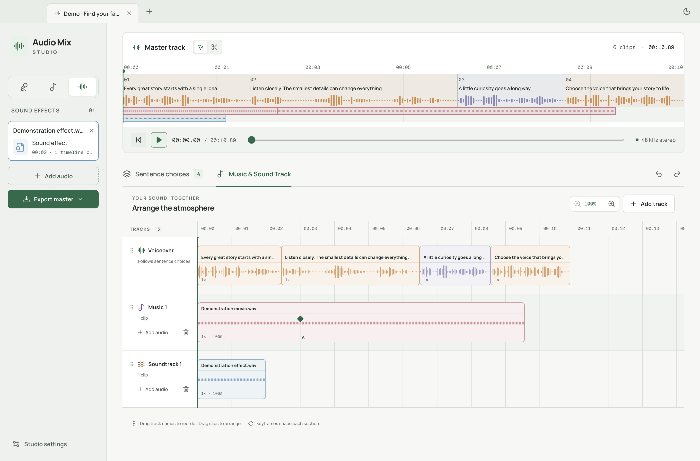

<p align="center"></p>

# Audio Mix Studio

**Every sentence. Your favorite take.**

A local macOS audio suite for turning several AI voice recordings into one narration, then layering music and sound effects. Import your ElevenLabs takes, listen to the different versions of each sentence, and pick your favorite. Your master track updates as you choose.

Built for faceless YouTube channels, voiceovers, and anyone who has ever thought, “I like the first half of take one and the ending of take two.”



## What you can do

- **Work in project tabs.** Open several mixes, double-click a tab to rename it, and close/reopen tabs without losing their edits. All valid open tabs and the active tab recover after restart.
- **Choose light or dark mode.** Use the top-right appearance button, or choose Light/Dark/System in settings. Larger text and stronger contrast keep both modes readable.
- **Compare sentences, not entire files.** Preview variations side by side and click anywhere on a card to select it. The play button previews without changing your choice.
- **Replace just one sentence.** Click **Add audio** on its row, or drop a short recording onto that sentence. The file becomes another choice for that sentence only; preview and select it when ready. Your existing choice and the rest of the mix stay intact.
- **Keep the original pacing.** Automatic cuts meet halfway through the silence between sentences. Selecting a complete take in its original order at 1x, with no added pauses or fades, preserves its complete source audio.
- **Control speed and joints.** Change speed from 0.5x to 2x in 1% steps without changing pitch, using SoundTouch—the tempo engine used by Audacity’s Change Tempo effect. Hover a divider to set the preceding fade-out, extra pause, and following fade-in. All defaults start at zero.
- **Match meaning across scripts.** Codex groups the same idea even when the wording changes. Extra sentences become their own groups, with only the takes that contain them.
- **Build a soundtrack.** Open **Music & Sound Track** for a synchronized waveform timeline with one voiceover reference, Music 1, and Soundtrack 1. Add music/effect tracks, drag their names to reorder, and confirm before deleting.
- **Shape each clip.** Stage clips in a track’s **+** dialog, drag them into position, and save. Click a clip for volume, speed, fade timing, illustrated fade curves, and a custom curve control.
- **Edit between keyframes.** Add a keyframe at the main cursor to define another section. Each section has its own speed, volume, and fades; later sections move with its duration. Voiceover controls change sentence speed and keep neighboring narration snapped together.
- **Hear the final sequence.** The master stays at the top, with playback, seeking, and color-coded source clips. Scroll or pinch over it to zoom; scroll horizontally to pan. Hover a clip to read its full sentence. Take cards show each source’s share of the audible mix.
- **Cut directly in the master.** Use the scissors beside **Master track**, then drag across a range to exclude it. Gray ranges remain visible for editing; playback jumps over them and export removes them without added silence. Right-click a gray range and choose **Restore audio**, or Undo. The pointer tool returns to click-to-seek.
- **Follow the narration.** Master playback subtly highlights the current sentence and scrolls the Sentence choices list to it.
- **Keep control.** Skip a sentence, move it up or down, combine pieces from different takes, and undo or redo edits.
- **Export real audio.** Download stereo 48 kHz, 24-bit WAV or 320 kbps MP3, with optional tiny edge fades to reduce clicks.
- **Save your work.** Automatic session recovery plus portable project files with their source audio. Export the complete transcript/alignment JSON too.
- **Choose your models.** WhisperX defaults to `large-v3-turbo`; missing local models download with progress and cancellation. Sentence-grouping settings use your installed Codex CLI’s live model catalog, supported reasoning levels, and Fast option.

There is no chat interface. AI organizes your recordings in the background; you decide which delivery sounds best.

## Requirements

The initial desktop release supports **macOS 13 or later on Apple Silicon (M-series)**.

| Tool                        | Purpose                                      | Setup                                                                                 |
| --------------------------- | -------------------------------------------- | ------------------------------------------------------------------------------------- |
| FFmpeg and FFprobe          | Decode, waveform, preview, export            | `brew install ffmpeg`                                                                 |
| SoundTouch (`soundstretch`) | Pitch-preserving tempo, shared with Audacity | `brew install sound-touch`                                                            |
| Codex CLI                   | Group equivalent sentences                   | Install [Codex CLI](https://developers.openai.com/codex/cli/), then run `codex login` |
| WhisperX 3.8.6              | Local transcription and word timing          | Prepared by the app in a private Python environment                                   |

Open **Studio settings** to check all tools. If Codex is missing or signed out, the app explains how to install/sign in; existing projects remain editable; the first narration import needs speech analysis to succeed. Discovery includes common Homebrew and `~/.local/bin` locations, so launching from Finder works without a shell PATH.

The transcription integration is adapted from [Vandashi](https://github.com/igormidev/Vandashi). It uses exactly the same WhisperX engine, CPU int8 inference, pinned model revisions, Silero speech detection, and word alignment. An existing verified Vandashi installation and downloaded model are reused read-only. Other downloads stay in Audio Mix Studio’s own cache. Vandashi does **not** need to be installed.

The default model is `large-v3-turbo`. On a new Mac, select **Prepare model** in settings to install the engine and download it. A missing selected model is also prepared during transcription. The first setup needs internet access, several GB of free disk space, and time to download Python dependencies and model weights. English and other supported alignment languages may download a separate word-timing model the first time they are used.

Available models: `tiny`, `base`, `small`, `medium`, `large-v3`, `large-v3-turbo`. Smaller models need less memory and may be less accurate. CPU transcription speed depends on your Mac and recording length.

## Run locally

Install [Node.js 22.12 or newer](https://nodejs.org/) and the tools above, then:

```sh
git clone https://github.com/igormidev/audio-mix-studio.git
cd audio-mix-studio
npm ci
npm run dev
```

For a production build:

```sh
npm run build
npm start
```

Build a macOS app or installer:

```sh
npm run package:dir
npm run package:mac -- --arm64
```

Outputs go into `release/`. Local builds are unsigned unless you configure your own Apple signing/notarization credentials. The repository does not include a signed/notarized public release or any credentials.

## Project tabs

Use **+** in the title bar (⌘N) for a new mix. Double-click its name to rename it; Enter saves the name and Escape cancels. Click **×** or press ⌘W to close it. ⇧⌘T or **File → Reopen closed tab** restores one of the last 20 closed tabs. Closing the last tab opens a blank mix.

Each tab keeps its own selections, manual cuts, view, and undo history while open. Switching tabs stops audio from the previous tab. A busy tab stays open until its operation finishes or is cancelled. Transcription/model setup runs one job at a time; imports, saves, and exports can run in other tabs. Background results update their original tab.

Explicit Save still produces a portable project and audio folder. The workspace also saves all open and recently closed mix snapshots automatically. A copied portable project opens independently; opening the same file again focuses its existing tab. Undo history is retained when closing/reopening during the same app session, while restart restores the saved edits.



## Your first mix

1. **Import your narration.** The first file must pass real WhisperX transcription and sentence grouping before it enters the project. A failed analysis leaves the project unchanged. WAV, MP3, M4A, AAC, FLAC, OGG, Opus, AIFF, and other common audio formats are supported. Imports are local copies; originals stay untouched.
2. **Classify later imports.** Each subsequent file opens a listening dialog: play/pause, seek, skip back/forward, and audition at up to 2x. Choose **Voiceover**, **Sound effect**, or **Music**. Voiceovers become narration choices; music and effects stay in their own libraries. Use the sidebar icon tabs to switch libraries. For additional full narration takes, click **Group sentences**; progress is visible and cancellable.
3. **Choose each sentence.** Preview the variations, then click the card you prefer. A sentence that appears in only one recording has one option. The first available take is selected initially; AI does not pretend to judge sound quality from text.
4. **Add music and sound effects.** Open **Music & Sound Track**, click **+** beside a track, and drag library audio onto its timeline. Arrange clips and save. Zoom applies across all tracks and the main cursor stays synchronized with the master. Click a music/effect clip to edit its settings or add keyframes. The voiceover lane exposes speed only; sentence choices remain the narration editor.
5. **Export master.** Use the button below **Add audio** in the sidebar. Choose WAV for editing in your video app, or MP3 for a smaller file. Tabs save automatically; **File → Save project** (⌘S) creates a portable copy.

Open **Quick guide → Let’s make a mix** for three real, locally synthesized takes with shared and unique sentences. The sample uses an empty tab if one is available; otherwise it opens a new tab. It never replaces a mix containing audio. Quick guide appears above Studio settings until the first successful master export, and remains available inside Studio settings afterward. Demo groups are prepared examples; they are labeled as a demo and do not imply an AI analysis ran.



### A few useful details

- Sentence groups define master order. Within a group, enabled pieces play in take/import order, then source time. Enabling two full variations plays both; it does not mix them over one another. **Custom mix** identifies these selections.
- Automatic boundaries partition each source from its first sample to its last. The gap between two speech ranges is divided at its midpoint, so half stays with each sentence; source silence is retained. Boundaries are rounded to the 48 kHz sample grid. Trims and cuts remain explicit user edits.
- Existing unedited automatic cuts are migrated when their original transcript and boundaries can be verified. Ambiguous legacy cuts, manual trims, and splits are preserved. Regroup an older manually edited project to create a fresh complete partition; Undo remains available.
- To replace a sentence, use its **Add audio** button or drop one or more short files onto that row in **Sentence choices**. Only the hovered sentence is highlighted. Each complete file becomes an unselected alternative there, including its original silence, without transcription or AI grouping. Undo removes the addition. Drops onto search, dividers, or blank areas in Sentence choices do not import full takes. Sentence-only files stay attached when regrouping preserves their sentence; if a target cannot be identified safely, regrouping stops and keeps your current mix.
- Master cuts are saved independently of your take choice. Switching to another take and back preserves the excluded ranges. Sentence previews omit the cuts. The timeline retains gray ranges while its playback/export clock counts only audible audio and explicit joint pauses.
- Master following scrolls only Sentence choices during master playback. Previewing a variation, opening a dialog, searching, or using the music workspace does not move that list.
- Regrouping a full take with master exclusions stops before replacing your edits; restore its gray ranges first. Sentence-only alternatives retain their exclusions under the existing safe regrouping rules.
- Split pieces retain their sentence text as context. Choosing that take again selects all surviving pieces. A variation preview plays those pieces in order, including any trims.
- Hover the divider between audible sentences for **fade-out · pause · fade-in** controls. Pauses add silence; fades change volume at the two edges without overlapping clips or shortening the mix. In **Studio settings → Joints**, set independent default fade-in, fade-out, and pause values. All start at 0 ms. Each joint inherits defaults for fields without an explicit override. Skipping a sentence reconnects the neighboring audible sentences.
- Sentence speed affects both variation previews and the master/export. Fades can be up to 5 seconds and pauses up to 10 seconds; fades are limited by the actual clip duration.
- Where forced alignment cannot reliably cover all spoken text, the app keeps the real ASR segment timestamps. It does not fabricate word timing.

### Keyboard shortcuts

| Shortcut     | Action                         |
| ------------ | ------------------------------ |
| Space        | Play/pause master              |
| ⌘+ / ⌘− / ⌘0 | Zoom master in / out / fit     |
| ⌘N           | New project tab                |
| ⌘W           | Close project tab              |
| ⇧⌘T          | Reopen closed tab              |
| ⇧⌘] / ⇧⌘[    | Next / previous project tab    |
| ⌘I           | Import audio                   |
| ⌘O           | Open project                   |
| ⌘S / ⌘⇧S     | Save / Save as                 |
| ⌘E           | Export master                  |
| ⌘Z / ⌘⇧Z     | Undo / Redo                    |
| Escape       | Stop playback / leave cut mode |

## Your files and privacy

Audio normalization, WhisperX transcription, word alignment, waveform analysis, and exports run on your Mac. No audio is sent to Codex. **Transcript text is sent through your installed, signed-in Codex CLI** for semantic grouping, using your existing account and usage allowance. Internet access is needed for this step. The app uses Codex’s noninteractive [structured output](https://developers.openai.com/codex/noninteractive) workflow with an ephemeral read-only job, without user/project instructions or shell/web tools. Each project stores its Codex model, reasoning level, and Fast preference. Following Vandashi’s background-task defaults, new projects request GPT-6-Luna with Medium reasoning and Fast off. Options come from the installed CLI’s paginated `model/list`; if an option is unavailable, selection falls back to the current account default and a supported reasoning level. Fast maps to the supported priority service tier. The app does not require an OpenAI API key or expose a chat.

App data lives at:

```text
~/Library/Application Support/Audio Mix Studio/
  media/                 imported normalized audio and media index
  workspace-session.json open/closed mixes, active tab, theme, and transcripts
  last-session.json      previous-version session, retained during migration
  preferences.json       whether a master has ever been exported
  transcription/         Python runtime, model downloads, and cache
```

Upgrading preserves and migrates the previous session. Restore validates each tab independently: a missing or unreadable cached source silently omits that tab while the other tabs remain available. Deleting the original download does not affect the app’s imported copy. Future incompatible workspace formats start fresh; incompatible tabs are omitted without discarding compatible tabs. Before replacing an unreadable or incompatible snapshot, the app preserves an exclusive recovery copy. The first-export preference survives workspace resets.

Explicit **Save** creates `My mix.mixstudio` and `My mix.assets/` beside it. Keep both together when moving or backing up a project. The JSON contains your transcript and selections; the assets folder contains copied source audio. Saved portable projects do not depend on the original download folder or the app’s media cache.

There is no app analytics or hosted storage. Downloading dependencies/model weights contacts their official distribution hosts; Codex uses its existing authentication and network connection. Do not commit personal audio, transcripts, project files, or model caches to GitHub.

## Limits of the first version

- Apple Silicon macOS only; no Intel/Windows/Linux installer.
- Up to 50 source tracks and 20,000 segments in a project; exports support up to 5,000 enabled clips. Each source may be up to 16 GiB and 12 hours. Very large transcripts are rejected with an explanation when they exceed one AI analysis request (1.5 MB of input JSON); split those into smaller projects.
- Semantic matches are proposals. Review them, especially with substantially rewritten scripts, repetitions, or noisy transcription. Codex does not hear the audio or automatically choose the best sounding delivery.
- Mixing includes clip gain, speed, fades, and section keyframes. It does not include loudness normalization, equalization, pitch correction, or an ElevenLabs account integration.
- Keyframes are source-time section boundaries. Settings apply to the section after a keyframe; speed is constant within each section, rather than continuously ramping between rates. Music/effect placements stay at their absolute timeline positions when narration speed changes.
- Summed tracks can exceed full scale. Lower clip volumes when layering several loud sources; the mixer does not silently normalize your levels.
- Setup requires network access. A completely fresh Python installation is a different path from reusing an existing verified environment; see verification notes below.

## Development and verification

```sh
npm run check       # strict TypeScript, ESLint, production build
npm test            # domain, edit history, playback planning, real FFmpeg, adapters
npx tsx scripts/smoke-electron.ts  # production Electron IPC/media, isolated profile
npx tsx scripts/smoke-ui.ts        # sentence choices and voiceover speed interactions
npx tsx scripts/smoke-tabs.ts      # tabs, background ownership, themes, restart, exact export
npx tsx scripts/smoke-editing.ts   # compact editor, speed, joints, zoom, guide, models
npx tsx scripts/smoke-master-cuts.ts # master range cuts, cursor jumps, restore, sentence follow
npx tsx scripts/smoke-snippets.ts  # sentence-only import/drop, history, export, recovery
npx tsx scripts/smoke-first-voiceover.ts # real first-source speech rejection/verification
npx tsx scripts/smoke-music.ts       # classified imports, multitrack, keyframes, export/recovery
npx tsx scripts/smoke-recovery.ts  # per-tab missing media, future formats, export preference
npx tsx scripts/smoke-installed.ts # installed /Applications bundle, minimal Finder PATH
```

Run native smoke scripts sequentially so generated speech and window-focus checks do not compete.

FFmpeg tests exercise real generated audio, including complete-source sample equality with leading/internal/trailing silence, pitch-preserving speed, exact pause/fade durations, preview/export equivalence, clip-order frequency checks, and WAV/MP3 durations. Adapter tests reject invalid/incomplete AI ranges and verify download/cancellation handling. Tab verification covers separate undo histories, background-operation ownership, rename, close/reopen, theme restoration, and byte-identical WAV output across restart. Native smoke runs keep Chromium’s OS sandbox enabled and use the production media protocol. The media smoke replaces native dialog answers; the tab smoke also holds controlled analysis and setup replies to verify background ownership and the model-setup cancel button without downloading a model.

The new model controls were also verified with the actual installed CLI: live account-model discovery and a GPT-6-Luna / Medium / Fast grouping run with shared, paraphrased, and unique sentences.

The initial implementation was verified on an Apple Silicon Mac with the actual installed WhisperX and authenticated Codex CLI: two locally generated speech takes, default-model transcription/word alignment, semantic paraphrase matching, and a sentence unique to one take. A previously missing `tiny` model was downloaded with progress, verified, loaded, and discovered. A completely new multi-GB Python environment installation was not repeated on that already configured Mac.

See [architecture](docs/ARCHITECTURE.md) for boundaries, data flow, persistence, and security decisions. Contributions should keep the editing workflow simple and test meaningful audio behavior.

## Credits and license

MIT © 2026 Igor Miranda Souza. Transcription bootstrap/engine adapted from [Vandashi](https://github.com/igormidev/Vandashi), with its [MIT notice](resources/transcription/VANDASHI-LICENSE.txt) preserved. See [transcription resources](resources/transcription/README.md) for upstream engine/model licenses. Electron, React, FFmpeg, SoundTouch, WhisperX, and Codex retain their own licenses. FFmpeg, SoundTouch, and Codex are external installations, not bundled in the app. Audacity source was inspected for its Change Tempo integration; no Audacity source is copied or linked into this MIT application. See [tempo implementation](docs/TEMPO.md).
